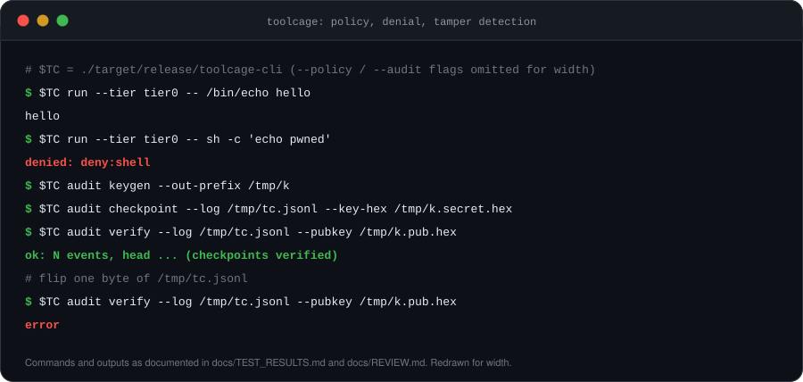
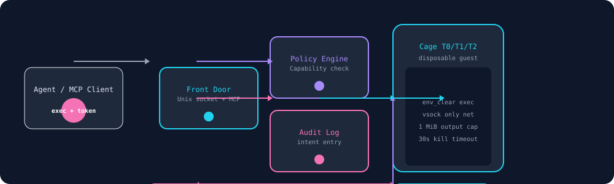
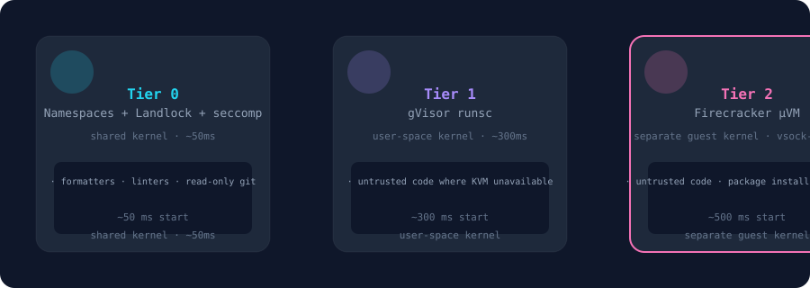
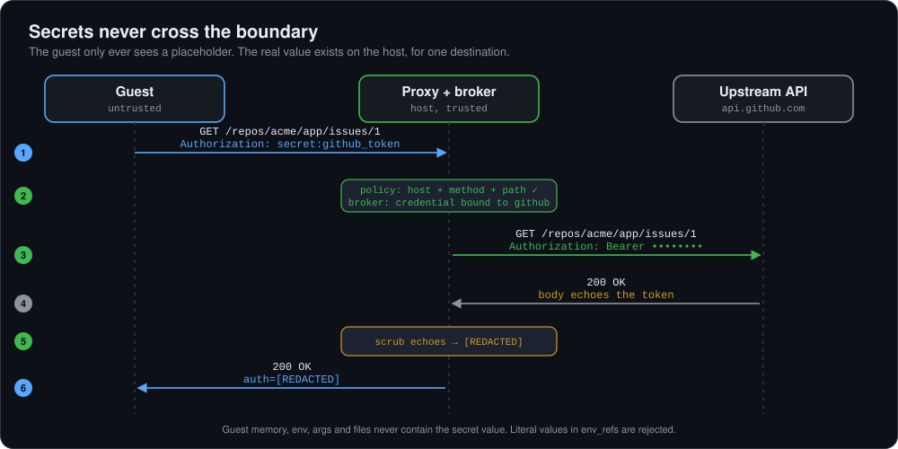
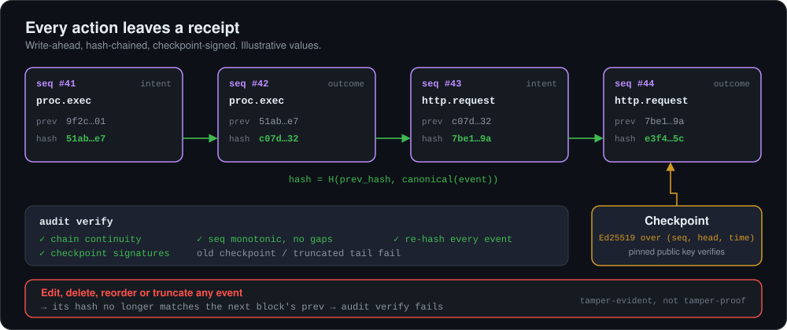

<div align="center">


**A local-first Rust runtime that puts a policy engine, a credential broker, an egress proxy, and a tamper-evident audit log between an AI agent and everything it touches.**

[](LICENSE)


[Quickstart](#quickstart) · [Why](#why-toolcage) · [Architecture](#architecture) · [Invariants](#the-seven-invariants) · [Policy](#policy) · [CLI](#cli-reference) · [MCP](#mcp-front-door) · [Limits](#status-and-known-limits) · [Threat model](docs/THREAT_MODEL.md)

</div>

---



## Why toolcage

A sandbox that only stops escapes misses what actually goes wrong with agents. Agents read untrusted content, call third-party tools, and install packages. The failure modes are:

- A prompt injection in a web page or CSV tells the agent to **leak an API key**.
- A malicious **MCP server or dependency** runs with the agent's privileges.
- Something goes wrong and nobody can say **what the agent did**, or trust the log that says so.

toolcage is the **policy, secrets, and evidence layer** on top of isolation. It is not another code-interpreter box.

| Risk | What toolcage does about it |
|---|---|
| Injection says "send me the key" | The guest never holds the key. A host-side broker injects it into requests to allowed destinations only, and strips it from responses. |
| Poisoned MCP server or package | Runs as a contained guest process under the same policy and audit trail as everything else. |
| Agent exfiltrates through an allowed tool (`git push`) | Per-destination method, path, and byte budgets, plus human approval gates. |
| Over-broad delegation | Capability tokens can only be **narrowed** when delegated, never widened. |
| "What happened, and can I trust the record?" | Every decision is hash-chained and checkpoint-signed. `audit verify` fails on any edit, deletion, or reordering. |

## Quickstart

**Requirements:** Linux and a stable Rust toolchain. Tier 0 uses user namespaces, cgroup v2, Landlock, and seccomp; Tier 1 needs gVisor (`runsc`); Tier 2 needs Firecracker and `/dev/kvm`. Run `doctor` to see what your host supports.

```bash
cargo build --release
TC=./target/release/toolcage-cli      # adjust if your binary is named differently

# 1. Probe the host (prints userns, cgroup2, landlock_abi, seccomp, kvm)
$TC doctor

# 2. Run under policy + audit (argv arrays only, no shell)
$TC run --policy schemas/policy-v0.yaml --audit /tmp/tc.jsonl \
        --tier tier0 -- /bin/echo hello

# 3. The evil twin: denied, and the denial is logged
$TC run --policy schemas/policy-v0.yaml --audit /tmp/tc.jsonl \
        --tier tier0 -- sh -c 'echo pwned'
# denied: deny:shell

# 4. Sign the log, verify it
$TC audit keygen     --out-prefix /tmp/k
$TC audit checkpoint --log /tmp/tc.jsonl --key-hex /tmp/k.secret.hex
$TC audit verify     --log /tmp/tc.jsonl --pubkey  /tmp/k.pub.hex
# ok: N events, head ... (checkpoints verified)

# 5. Flip one byte of /tmp/tc.jsonl and verify again: it fails.
```

Secrets through the proxy:

```bash
$TC fetch --policy schemas/policy-v0.yaml --audit /tmp/tc.jsonl \
  --host github.internal --method GET --path /repos/acme/app/issues/1 \
  --cred github_token --secret-value s3cr3t
# body: upstream api.github.com/... ok auth=[REDACTED]
```

> `--secret-value` on the command line is a demo convenience. It ends up in shell history and the process list. Don't pass real credentials this way.

The demo flow was last verified end to end on 2026-10-19 ([`docs/TEST_RESULTS.md`](docs/TEST_RESULTS.md)).

## Architecture



Every tool call crosses one small trusted core, the **supervisor**. It decides, records, isolates, proxies, and proves. Everything else (model output, guest processes, tool and MCP output, file and web content) is untrusted.

**Trusted, and kept small:** supervisor, policy engine, credential broker, egress proxy, audit writer.

Decision order for every request:

```
canonicalize at the enforcement point
  → operator forbid wins
  → capability token checks
  → approval gate (timeout = deny)
  → write intent to the log     ← if this fails, the action is denied
  → act
  → write outcome
```

### Isolation tiers



A tool declares `min_isolation`. If the host can't provide it, the call is **denied and audited**. It is never run at a weaker tier. Tier 0 shares the host kernel; use Tier 1 or 2 for hostile code.

There is no unsandboxed fallback: without a wired isolation backend the call is **denied** (`isolation:unavailable`), never direct-spawned on the host. The only unconfined mode is the explicit `--unsafe-no-isolation` (tier0 only, refused for tier1/2), and those runs are audited as `isolation:unisolated`.

## The seven invariants

These are the security claims toolcage makes. Each one is tied to a test suite, so a regression is a failing test and not a vibe.

| | Invariant | Enforced and tested by |
|---|---|---|
| **I1** | No guest process reaches any network except through the egress proxy | Escape suite: raw sockets, DNS, ICMP, IPv6, tunnels; proxy alias, metadata, and budget tests |
| **I2** | No credential value appears in guest memory, files, environment, or arguments | Planted canary secrets scanned for; broker encryption and rotation tests |
| **I3** | A token can only be narrowed on delegation, never widened — and can't be minted without the host key | 200-seed multi-hop property test; narrow / widen / revoke / tamper / forgery tests |
| **I4** | Every decision is recorded before the action runs | Write-ahead intent logging; chaos tests that kill the supervisor mid-action |
| **I5** | Any edit, deletion, or reordering of the log **below the newest retained checkpoint** is detected by `audit verify` (see [Audit log](#audit-log) for the tail caveat) | Mutation tests; checkpoint truncation and old-checkpoint tests |
| **I6** | The guest cannot loosen its own policy or reach the policy engine | `sh -c` denial, path traversal, mount checks, adversarial guest-agent validation |
| **I7** | After teardown, no session state is reachable from another session | Cross-session canary tests |

## Policy

One YAML file per tool. Anything not allowed is denied.

```yaml
tool: dependency-updater
min_isolation: firecracker
fs:
  mounts:
    - path: /workspace
      mode: rw
      source: session-copy
net:
  mode: allowlist
  hosts:
    - host: registry.npmjs.org
      methods: [GET]
    - alias: github
      methods: [GET, POST]
      paths: ["/repos/acme/app/**"]
credentials:
  - name: github_token
    use_with: github
exec:
  # Optional: explicit allowlist of binaries that may run (argv[0] basenames,
  # version-tolerant). When set, ONLY these run — this is the fix for the
  # shell/interpreter denylist being inherently incomplete. Omit for the v0
  # denylist-only behaviour.
  allowlist: [dependency-updater, git]
approval:
  require_for:
    - http.request: { methods: [POST], hosts: [github] }
```

- `sh -c` and `bash -c` are denied. Commands are argv arrays.
- **`exec.allowlist`** (optional) names the binaries that may run — anything else is denied, closing the wrapper/rename/flag-spelling holes a denylist leaves. The denylist still applies on top: an allowlisted interpreter cannot take inline code (`-c`, `-e`, `-p`, `-r`, …) or a shell script file.
- Hosts and methods match case-insensitively. Mount paths are canonicalized (`/workspace/a/../b` becomes `/workspace/b`) and `..` escapes are denied.
- Cloud metadata endpoints (`169.254.169.254`, `metadata*`, `instance-data`) are never reachable.
- Credentials are bound to destinations with `use_with`. They are not attached to requests for any other host.
- Approval gates pause the call (exit code 3 on the CLI). A timeout is a denial.

### Capability tokens

```bash
$TC token keygen    --out-prefix /tmp/k                          # host secret
$TC token mint      --rev root-1  --out root.tok  --key-hex /tmp/k.key.hex
$TC token attenuate --parent root.tok --rev child-1 --out child.tok \
                    --hosts github --key-hex /tmp/k.key.hex      # narrow only
```

Tokens carry scoped, expiring authority and are revocable. Tags are **HMAC-SHA256 keyed with the host secret**, so a guest that reads a token can neither mint a sibling nor widen anything: forged and hand-edited tokens fail verification and are denied. Expiry is enforced, paths are traversal-normalized, and an empty rights list grants nothing on that axis. `fetch` requires a policy allow **and** a token that verifies against `--key-hex` — without a key, a presented token is denied, never waved through.

Revocation covers the **whole subtree**: revoking a `rev_id` kills every token delegated from it, including ones that were never tracked explicitly, while revoking a child never affects its parent. The ancestor walk terminates even on hostile link shapes.

## Secrets



- The guest holds `secret:name` placeholders. Literal values in `env_refs` are rejected.
- The broker store is **encrypted at rest** and supports rotation; its `Debug` output is redacted.
- The proxy resolves DNS, enforces `host + method + path`, and attaches the credential upstream.
- Responses are scrubbed. If an API echoes the token, it's removed before the guest sees it.
- Package installs use two-phase sessions: setup talks only to a pinned mirror, then the run phase gets a narrowed or closed network.
- Per-destination byte and request budgets are persisted (fsync'd) and survive restarts.

## Audit log



`audit verify` checks chain continuity, monotonic sequence with no gaps, a re-hash of every event, and checkpoint signatures against a pinned public key. Old checkpoints and truncated tails fail. The writer re-verifies the chain on open, so a corrupt log is never extended.

This is **tamper evidence, not tamper prevention.** An attacker who controls the host can rewrite and re-sign the log unless the public key and checkpoints are stored somewhere they can't reach.

**Scope of detection.** The chain hash is unkeyed (SHA-256 over public fields), so anyone can recompute a self-consistent chain; what makes it tamper-*evident* is the signed checkpoints pinning `(seq, head)` to a prefix. Concretely: tampering **below the newest retained checkpoint** is detected, but edits, deletions, or reordering of the **tail after that checkpoint** are not — unless a newer checkpoint is anchored externally (a second machine, a transparency log). Delete the newer `<log>.checkpoint.*` files, rewrite the tail, and `audit verify` passes. Store checkpoints somewhere the log writer can't reach if you need tail integrity.

`panic` freezes a log by appending a `deny-all` event and a `.tainted` marker.

## CLI reference

| Command | Purpose |
|---|---|
| `$TC doctor` | Probe the namespace stack (userns/mount/net/ipc/pid/uts), cgroup v2, Landlock ABI, seccomp, `/dev/kvm` |
| `$TC run --tier T -- <argv>` | Policy check, audit intent, exec with cleared env (1 MiB streaming output cap, 30 s kill), audit outcome. `--unsafe-no-isolation` opts out of the cage (tier0 only, audited) |
| `$TC check-net --host H --method M --path P` | Proxy decision and upstream resolution, no network touched |
| `$TC fetch [--token T] [--approve]` | Proxy + broker fetch with dual auth and approval pause; scrubbed body; both steps audited |
| `$TC token keygen / mint / attenuate` | Host MAC key; create root tokens; delegate narrower ones |
| `$TC image sign --dir D --key-hex K` | Ed25519-sign a golden image manifest (`signature.bin`) — what `GoldenImage::load` verifies before trusting the image |
| `$TC mcp serve / call` | Stdio JSON-RPC front door |
| `$TC audit keygen / checkpoint / verify` | Keys, signed checkpoints, pinned-key verification |
| `$TC panic --audit LOG` | Freeze a log after a suspected compromise |

Guest-agent protocol (`Exec` / `PutFile` / `Heartbeat`): bounded argv, no NUL bytes, `env_refs` must be `secret:name`, writes confined to `/workspace`.

Clients: [`clients/python/toolcage.py`](clients/python/toolcage.py), [`clients/ts/toolcage.ts`](clients/ts/toolcage.ts).

## MCP front door

`mcp serve` exposes four tools over stdio JSON-RPC. The wire protocol is **JSON-RPC 2.0** (version-checked requests, standard error codes, responses carry exactly one of `result`/`error`, notifications get no reply, bounded frames and ids). Each tool is a policy-checked action:

| Tool | Action | Notes |
|---|---|---|
| `run_command` | `proc.exec` | argv array; `sh -c` denied; runs inside the `--tier` cage (default tier0), denied without one |
| `read_file` | `fs.read` | mount-checked |
| `write_file` | `fs.write` | mount-checked |
| `http_fetch` | `http.request` | proxy + broker, dual auth |

Third-party MCP servers run as **guest processes** under the same policy and audit trail, so a poisoned tool becomes a contained process. **Learn mode** (`--learn` on `mcp call`/`mcp serve`) records denials and prints a proposed allowlist addition at exit so you don't write policy by hand — proposals are for operator review and are never applied automatically.

## Tests

`cargo test --workspace` runs the full suite green with clippy clean — the current count and per-suite breakdown live in [`docs/TEST_RESULTS.md`](docs/TEST_RESULTS.md) (regenerated from the run; counts here went stale every commit when duplicated). Beyond unit tests the suite includes:

- **Escape suite** against the policy and proxy (I1, I6), and a Tier 2 escape suite asserting the design closes each exit — vsock-only with no network device ever configured, jailer confinement of the VMM process, and a control-channel escape matrix
- **Fuzzing** of the policy, guest-agent, audit, and proxy parsers
- **Chaos tests** that fail the audit disk, proxy, and broker, revoke tokens mid-run, and exceed budgets, asserting every case fails closed
- **Property tests** over capability chains (200 seeds): a delegation never widens, and revoking an ancestor kills the whole subtree
- **Mutation tests** on the audit log (flip, delete, reorder, truncate)
- **Tier 0 live isolation tests**: command executes, network namespace blocks egress, Landlock blocks file access, environment is cleared

Live Tier 0 tests **skip loudly** on hosts that can't provide the namespace stack or Landlock (GitHub's hosted runners allow user namespaces but block mount/net/ipc/pid/uts — probes test the real thing, not sysctls), and `run --tier tier0` refuses to start with a clear error instead of downgrading.

Full breakdown: [`docs/TEST_RESULTS.md`](docs/TEST_RESULTS.md).

### Benchmarks

Measured on the development host, October 2026. Re-run `scripts/bench.sh` on yours.

| Metric | Target | Result |
|---|---|---|
| Policy decision p99, in-process | < 5 ms | **404 ns** (p50 340 ns, max 6.0 µs, n = 10k) |
| Audit append, fsync per event | ≥ 10,000 eps | **~270,000 eps** (n = 5k) |
| `run` end-to-end, Tier 0 | n/a | 53 ms/call (n = 200, measured before isolation was enabled) |
| Tier 2 warm-claim start latency | track p50/p99 by tier | p50 19.9 ms, p99 20.2 ms (n = 20; includes the mock API's ~10 ms accept poll — real firecracker is sub-ms, so read it as the orchestration ceiling and its trend) |
| Supervisor idle memory | < 100 MB | not yet measured |

The audit figure is filesystem-dependent (tmpfs may not flush durably) and is a baseline, not a durability claim. The 53 ms figure predates real isolation and will be higher now.

## Status and known limits

**toolcage is alpha and has not had independent security review.** The project's own review package ([`docs/REVIEW.md`](docs/REVIEW.md)) treats that review as a gate before any public security claim. Until it happens, treat the invariants above as *tested design goals*, not audited guarantees.

| Area | State |
|---|---|
| Tier 0 (namespaces, Landlock, seccomp) | Implemented, with live isolation tests. Landlock is **mandatory** (fail-closed): if the kernel can't provide it, session creation is denied and the child refuses to run — no silent fallback to namespaces-only. The handled rights follow the running kernel's ABI: on Landlock ABI 1 (Linux 5.13–6.1), `refer` (ABI 2+) and `truncate` (ABI 5+) are **unrestricted** there — the kernel cannot bound a right it does not know. `doctor` reports the detected ABI. |
| Tier 1 (gVisor) | Functional as wired: `runsc create --bundle` with the upstream argument shape, a complete OCI spec (`process.args`, `cwd`, `/proc`, devices), SIGKILL + polled `delete` cleanup, and id/path validation. Not live-tested end-to-end on the build host (no `runsc` installed there); covered by arg-shape and spec-shape tests. |
| Tier 2 (Firecracker) | Functional as wired: the jailer actually launches the VM (nothing launched one before), `/boot-source` is configured before `InstanceStart` (Firecracker rejects a start without it), then machine-config → drives → vsock → start over the API; snapshot-restored VMs resume with `PATCH /vm {"state":"Resumed"}` (the `InstanceStart` action is for fresh boots only); warm-pool failures surface as errors (only an empty pool falls back to a fresh boot) and a failed pool VM is torn down, not leaked; and `destroy()` kills the firecracker process. REST ordering, the resume verb, pool failure handling, and the Tier 2 escape suite (vsock-only with no network device ever configured, jailer confinement of the VMM process, and a control-channel escape matrix) are tested against a mock API socket; the create-time socket check refuses symlinks and stale plants; warm-claim start latency is benchmarked in `scripts/bench.sh`. Not live-tested on the build host (no `firecracker`/`/dev/kvm` there). |
| seccomp-BPF | Defense in depth alongside namespaces + Landlock. The filter itself is valid — an invalid BPF addressing mode used to make `PR_SET_SECCOMP` fail with `EINVAL` on *every* kernel (the old note here blamed "some kernels"); that is fixed, and the workload runs under the filter **where the kernel accepts seccomp**. `doctor` probes yours: some kernel builds (including this dev host's) return EINVAL and Tier 0 continues with namespaces + Landlock, loudly. The blocklist is not exhaustive: the newer mount API (`fsopen`/`move_mount`/`fsmount`), `io_uring`, and `chroot` are not blocked. |
| Audit throughput | fsync per append (crash-safe). Group commit is the next step if throughput is ever needed. |
| Secret handling | `fetch --secret-value` takes the credential as a CLI flag, so it is visible to other local users via `ps`/`/proc/*/cmdline` and usually lands in shell history — despite "stays host-side". **Use `--secret-file` instead**: it is read host-side and never appears on argv. Keys written by `token keygen` / `audit keygen` are `0600`; the `--secret-value` path is not. |
| Scope | Linux only. No GPU workloads, no multi-tenant hosting, no Windows or macOS guests. |

Things the design does **not** do, by construction:

- It doesn't decide whether an *allowed* action is wise. An agent permitted to `POST` to a repo can do damage inside that scope. Use approvals and budgets on high-impact destinations.
- It doesn't protect a compromised host. The supervisor, broker, and log live on the host and are trusted.
- Tier 0 is not a defense against kernel exploits.

## Repository layout

```text
crates/
  supervisor/    exec (env_clear, argv hash, output cap, timeout kill), fetch_via_proxy, panic_freeze
  policy/        YAML v0 loader, allowlist + forbid evaluator, approval gates, escape tests
  proxy/         alias resolution, method/path enforcement, budgets, blocked-IP checks
  broker/        encrypted host-only secret store, inject-if-bound, echo scrubbing, canaries
  capability/    attenuate-only tokens, expiry, revocation, property tests
  approval/      require_for gates, out-of-band queue (timeout = deny)
  backend/       Tier trait + fail-closed honors()
  backend-ns/    Tier 0 driver + host probe
  backend-gv/    Tier 1 (gVisor runsc) driver
  backend-fc/    Tier 2 (Firecracker) driver, warm pool
  guest-agent/   PID 1 protocol with input validation
  mcp/           stdio MCP server, sandboxed host check, learn mode
  audit/         hash-chain writer, Ed25519 checkpoints, verifier library
  verify/        standalone log verifier
  cli/           the command-line binary
clients/         Python and TypeScript clients
docs/            THREAT_MODEL.md, TEST_RESULTS.md, REVIEW.md
fuzz/            fuzz targets
images/          guest image build (manifest + sha256, per-host-class goldens)
schemas/         audit-event-v0.json, policy-v0.yaml
scripts/         doctor.sh, bench.sh
assets/          banner, architecture, tiers, secrets, audit and demo SVGs
```

## Security

Found a vulnerability or a broken invariant? Please report it privately through **Security → Report a vulnerability** on this repository instead of opening a public issue. Any finding that invalidates an invariant blocks public security claims until it is fixed.

## License

Apache-2.0. See [LICENSE](LICENSE).
