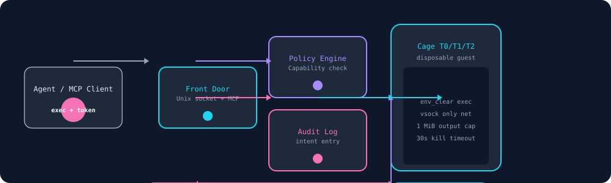
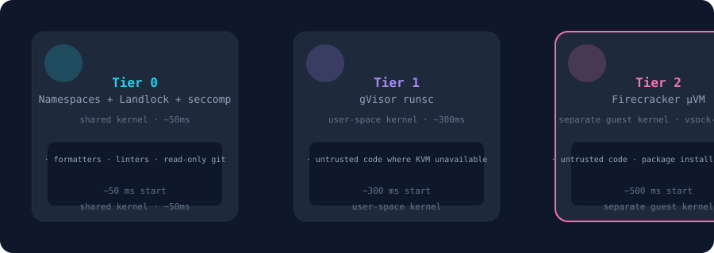

<p align="center">
  
</p>

<p align="center">
  <strong>Run AI agent tools under policy. Keep secrets out of the sandbox. Prove what happened.</strong>
</p>

<p align="center">
  <a href="https://github.com/VarunGore36/toolcage/actions"></a>
  <a href="https://crates.io/crates/toolcage-cli"></a>
  <a href="https://github.com/VarunGore36/toolcage/blob/main/LICENSE-MIT"></a>
  <a href="https://github.com/VarunGore36/toolcage/blob/main/docs/THREAT_MODEL.md"></a>
  <a href="https://github.com/VarunGore36/toolcage/blob/main/docs/REVIEW.md"></a>
</p>

---

## What is toolcage?

**toolcage** is a local-first agent sandbox. It sits between an AI agent (or any untrusted code) and your system, enforcing **policy**, **isolating execution**, **proxying egress**, **managing credentials**, and producing a **tamper-evident audit log** — all with a small, auditable trusted core.

| Guarantee | How it works |
|-----------|--------------|
| **Policy is law** | YAML allowlist, default-deny, `forbid:metadata` always wins |
| **Secrets never enter the guest** | Credentials injected host-side by broker; scrubbed from replies |
| **Egress is explicit** | Proxy resolves DNS, enforces host/method/path, byte/request budgets |
| **Isolation is tiered & fail-closed** | Tier 0 (namespaces+Landlock) → Tier 1 (gVisor) → Tier 2 (Firecracker); a tool declaring `min_isolation: firecracker` is **denied** if the host lacks `/dev/kvm` — never silently downgraded |
| **Audit is tamper-evident** | Hash-chain log with Ed25519 signed checkpoints; verify on open |

---

## Architecture

<p align="center">
  
</p>

### Three rules, no exceptions

1. **The guest never dials out** — all egress goes through the proxy
2. **The guest never holds a credential** — secrets injected host-side only
3. **No action without a log entry** — log write fails → action denied

---

## Isolation Tiers

<p align="center">
  
</p>

| Tier | Backend | Boundary | Kernel | Needs |
|------|---------|----------|--------|-------|
| **Tier 0** | `backend-ns` | User + net namespaces, cgroup v2, Landlock, seccomp | Shared with host | `userns`, `cgroup v2`, Landlock |
| **Tier 1** | `backend-gv` | gVisor `runsc` (user-space kernel) from OCI bundle | Intercepted by gVisor | `runsc` installed |
| **Tier 2** | `backend-fc` | Firecracker microVM, vsock-only guest, warm pool, golden images | Separate guest kernel | Firecracker + `/dev/kvm` |

> **Fail-closed**: If a tool declares `min_isolation: firecracker` and the host has no `/dev/kvm`, the call is **denied and audited** — it is never silently run at a weaker tier.

---

## Audit Log: Hash-Chain with Signed Checkpoints

<p align="center">
  
</p>

- Every event links to the previous hash: `hash = SHA256(prev || seq || payload)`
- Every **N** events, an **Ed25519 signed checkpoint** covers `(seq, head_hash, timestamp)`
- `toolcage audit verify` re-verifies the entire chain and all checkpoints on open
- Tampering (rewrites, truncation, same-length tail rewrites) is detected

---

## Quick Start

### Install

```bash
# From crates.io (when published)
cargo install toolcage-cli

# Or build from source
git clone https://github.com/VarunGore36/toolcage.git
cd toolcage
cargo build --workspace --release
# Binary at ./target/release/toolcage-cli
```

### 60-Second Demo

```bash
toolcage demo
# Creates a scratch directory, runs:
#   ✓ allowed command (echo hello)
#   ✗ denied shell (sh -c 'evil')
#   ✗ tampered audit log detection
```

### Your First Policy

Create `policy.yaml`:

```yaml
tool: my-agent
version: 0
min_isolation: tier0

fs:
  mounts:
    - path: /workspace
      mode: rw
      source: session-copy

net:
  mode: allowlist
  hosts:
    - host: api.github.com
      methods: [GET, POST]
      paths: ["/repos/**"]
    - host: registry.npmjs.org
      methods: [GET]

credentials:
  - name: github_token
    use_with: api.github.com

limits:
  cpu_seconds: 300
  memory_mb: 1024
  egress_bytes: 20000000
```

### Run a Command Under Policy

```bash
# Create audit log
touch audit.jsonl

# Run: allowed
toolcage run --policy policy.yaml --audit audit.jsonl -- /bin/echo "hello"

# Run: denied (shell inline code)
toolcage run --policy policy.yaml --audit audit.jsonl -- sh -c "rm -rf /"

# Run: denied (network not in allowlist)
toolcage run --policy policy.yaml --audit audit.jsonl -- curl https://evil.com
```

### Fetch via Proxy (Secrets Stay Host-Side)

```bash
# Store credential in broker (encrypted at rest)
toolcage broker insert --name github_token --value $GITHUB_TOKEN --use-with api.github.com

# Fetch: secret injected by broker, never touches guest argv/env
toolcage fetch --policy policy.yaml --audit audit.jsonl \
  --host api.github.com --method GET --path "/repos/owner/repo" \
  --cred github_token
```

### MCP Front Door (stdio JSON-RPC)

```bash
# Serve: exposes run_command, read_file, write_file, http_fetch
toolcage mcp serve --policy policy.yaml --audit audit.jsonl --tier tier0

# Call: single request (for tests)
toolcage mcp call --policy policy.yaml --audit audit.jsonl \
  --name http_fetch --args-json '{"host":"api.github.com","method":"GET","path":"/repos/owner/repo"}'
```

---

## CLI Reference

| Command | Purpose |
|---------|---------|
| `run` | Execute argv array under policy + audit |
| `check-net` | Dry-run a network request against policy |
| `fetch` | HTTP via proxy + broker (secrets host-side) |
| `token` | Capability tokens: `keygen`, `mint`, `attenuate`, `revoke` |
| `mcp` | MCP front door: `serve` (stdio), `call` (single) |
| `audit` | `verify`, `checkpoint`, `keygen`, `events` |
| `image` | Golden image: `sign`, `verify` |
| `doctor` | Environment health check (kernels, runsc, fc, Landlock) |
| `demo` | Self-contained 60-second tour |
| `panic` | Write operator panic event to audit log |

### Common Flags

| Flag | Description |
|------|-------------|
| `--policy` | Path to policy YAML |
| `--audit` | Path to audit log (JSONL) |
| `--tier` | `tier0` \| `tier1` \| `tier2` (default: `tier0`) |
| `--workspace` | Host path bind-mounted as `/workspace` (default: cwd) |
| `--unsafe-no-isolation` | **Escape hatch**: run unconfined (Tier 0 only, audited as `isolation:unisolated`) |

---

## Policy Schema (v0)

```yaml
tool: string                    # Tool identifier
version: 0                      # Schema version
min_isolation: tier0            # tier0 | tier1 | tier2

fs:
  mounts:
    - path: /workspace          # Mount point
      mode: rw                  # ro | rw
      source: session-copy      # session-copy | host-bind

net:
  mode: allowlist               # allowlist | deny
  hosts:
    - host: api.github.com      # Exact host or alias
      alias: github             # Optional alias
      methods: [GET, POST]      # Allowed methods
      paths: ["/repos/**"]      # Path prefixes (trailing /** only)

credentials:
  - name: github_token          # Credential name
    use_with: github            # Host/alias this secret binds to

limits:
  cpu_seconds: 300
  memory_mb: 1024
  egress_bytes: 20000000
  egress_requests: 1000

exec:
  allowlist: [git, cargo]       # Optional: ONLY these binaries may run

approval:
  require_for:
    - http.request:             # Action requiring approval
        methods: [POST]         # Optional: constrain methods
        hosts: [github]         # Optional: constrain hosts
```

> **Default-deny**: Unknown actions, hosts, paths → deny. `forbid:metadata` (cloud metadata, link-local) always wins.

---

## Capability Tokens

Mint → Attenuate → Revoke. Tokens are **narrow-only** (attenuation never widens).

```bash
# Generate HMAC key (host-side secret)
toolcage token keygen --out-prefix /path/to/keys

# Mint root token (broad rights)
toolcage token mint --rev root-1 --out root.json --key-hex /path/to/keys.key.hex

# Attenuate for a specific agent/session
toolcage token attenuate --parent root.json --rev session-42 \
  --hosts api.github.com --methods GET --budget 50000 \
  --out session-42.json --key-hex /path/to/keys.key.hex

# Revoke (kills whole subtree)
toolcage token revoke --rev session-42 --out revoked.json
```

Use with `--token` + `--key-hex` on `fetch`, `mcp serve`, `mcp call` for **dual-auth** (policy AND token).

---

## Clients

| Language | Package | Status |
|----------|---------|--------|
| TypeScript | `@toolcage/client` | `clients/ts/` |
| Python | `toolcage` | `clients/python/` |

```python
# Python example
from toolcage import Toolcage

tc = Toolcage(policy="policy.yaml", audit="audit.jsonl")
result = tc.run(["/bin/echo", "hello"])
print(result.stdout)
```

---

## Documentation

| Doc | Description |
|-----|-------------|
| [`docs/THREAT_MODEL.md`](docs/THREAT_MODEL.md) | Seven invariants, threat model, trust boundaries |
| [`docs/REVIEW.md`](docs/REVIEW.md) | Gate 2 security review package |
| [`docs/TEST_RESULTS.md`](docs/TEST_RESULTS.md) | Test results & benchmarks |
| [`schemas/policy-v0.yaml`](schemas/policy-v0.yaml) | Policy YAML schema |
| [`schemas/audit-event-v0.json`](schemas/audit-event-v0.json) | Audit event JSON schema |

---

## Security

- **Vulnerabilities**: `cargo-audit` (RustSec) runs on every push/PR, nightly, and as a release gate
- **Licenses**: `cargo-deny` enforces permissive-only, crates.io-only sources
- **Fuzzing**: `cargo fuzz` targets for proxy, policy, MCP, audit, capability, guest-agent
- **Reporting**: See [`SECURITY.md`](.github/SECURITY.md) — do not disclose in public issues

---

## Benchmarks (Release Build, Typical Laptop)

| Metric | Target | Notes |
|--------|--------|-------|
| Policy decision p99 | < 100 µs | YAML parsed once, hot path is pure Rust |
| Audit append throughput | > 100k eps | Hash-chain, batched fsync |
| CLI `run` baseline (no-op) | < 5 ms | Tier 0 namespace setup dominates |
| Proxy request overhead | < 2 ms | DNS + TLS + budget check |

Run locally:

```bash
./scripts/bench.sh
```

---

## Contributing

```bash
# Build & test
cargo build --workspace
cargo test --workspace
cargo clippy --workspace --all-targets -- -D warnings
cargo fmt --check

# Run benchmarks
./scripts/bench.sh
```

See [`CONTRIBUTING.md`](CONTRIBUTING.md) for details.

---

## License

Dual-licensed under **Apache-2.0** OR **MIT** at your option.

---

## Project Status

**Alpha** — API and policy schema may change. See [`CHANGELOG.md`](CHANGELOG.md) for history.

<p align="center">
  <sub>Built with <a href="https://www.rust-lang.org/">Rust</a> · Local-first · No telemetry · No phone home</sub>
</p>