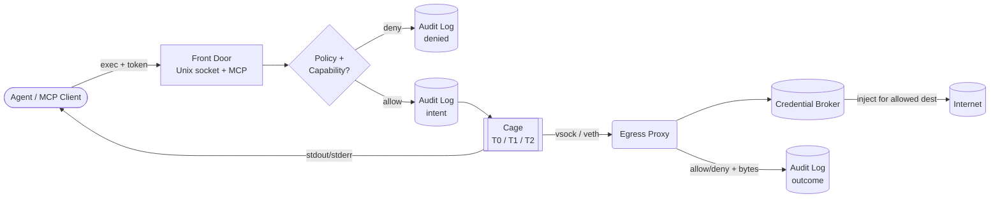

<div align="center">

<svg width="860" height="200" viewBox="0 0 860 200" xmlns="http://www.w3.org/2000/svg" role="img" aria-label="toolcage banner">
  <defs>
    <linearGradient id="bg" x1="0" y1="0" x2="1" y2="1">
      <stop offset="0%" stop-color="#0f172a"/>
      <stop offset="55%" stop-color="#1e1b4b"/>
      <stop offset="100%" stop-color="#0e7490"/>
    </linearGradient>
    <linearGradient id="accent" x1="0" y1="0" x2="1" y2="0">
      <stop offset="0%" stop-color="#22d3ee"/>
      <stop offset="100%" stop-color="#a78bfa"/>
    </linearGradient>
    <linearGradient id="cage" x1="0" y1="0" x2="0" y2="1">
      <stop offset="0%" stop-color="#22d3ee"/>
      <stop offset="100%" stop-color="#0e7490"/>
    </linearGradient>
  </defs>
  <rect x="0" y="0" width="860" height="200" rx="24" fill="url(#bg)"/>
  <g opacity="0.25" stroke="#22d3ee" stroke-width="1">
    <path d="M0 150 L860 130"/>
    <path d="M0 165 L860 145"/>
    <path d="M0 180 L860 160"/>
    <circle cx="720" cy="45" r="60" fill="none"/>
    <circle cx="720" cy="45" r="35" fill="none"/>
  </g>
  <g transform="translate(60,52)">
    <rect x="0" y="0" width="96" height="96" rx="20" fill="none" stroke="url(#accent)" stroke-width="4"/>
    <line x1="0" y1="24" x2="96" y2="24" stroke="url(#accent)" stroke-width="3"/>
    <line x1="0" y1="48" x2="96" y2="48" stroke="url(#accent)" stroke-width="3"/>
    <line x1="0" y1="72" x2="96" y2="72" stroke="url(#accent)" stroke-width="3"/>
    <line x1="24" y1="0" x2="24" y2="96" stroke="url(#accent)" stroke-width="3"/>
    <line x1="48" y1="0" x2="48" y2="96" stroke="url(#accent)" stroke-width="3"/>
    <line x1="72" y1="0" x2="72" y2="96" stroke="url(#accent)" stroke-width="3"/>
    <circle cx="48" cy="48" r="14" fill="#22d3ee"/>
    <circle cx="48" cy="48" r="6" fill="#0f172a"/>
  </g>
  <text x="180" y="95" font-family="monospace" font-size="56" font-weight="bold" fill="white" letter-spacing="2">toolcage</text>
  <text x="182" y="125" font-family="monospace" font-size="16" fill="#a5f3fc">isolate • attenuate • broker • prove</text>
  <rect x="180" y="140" width="220" height="26" rx="13" fill="none" stroke="#22d3ee" stroke-width="1.5"/>
  <text x="192" y="158" font-family="monospace" font-size="13" fill="#e0f2fe">local-first agent sandbox</text>
</svg>

<p>
  <a href="https://github.com/VarunGore36/toolcage"></a>
  
  
  
</p>

**Every agent tool call runs inside a disposable cage, with least-privilege capabilities, zero visible secrets, and a verifiable receipt.**

</div>

---

## What it is

`toolcage` sits between your agent and the OS. The agent asks to run something. `toolcage` decides, records, isolates, proxies, and proves.



No direct network from the guest. No credentials in the guest. No action without a log entry.

## The four guarantees

<div align="center">

| | Guarantee | How |
|---|---|---|
| <b>1</b> | **Disposable isolation** | One API, three backends. Picked per-tool by risk. Fail-closed. |
| <b>2</b> | **Capabilities, not ACLs** | Tokens narrow on delegate. Never widen. Revocable. |
| <b>3</b> | **Secret-free guest** | Broker holds secrets, injects at proxy for allowed dests only. |
| <b>4</b> | **Tamper-evident log** | `hash = H(prev_hash, canonical(event))` + Ed25519 checkpoints. |

</div>

## Isolation tiers

<div align="center">
<svg width="760" height="210" viewBox="0 0 760 210" xmlns="http://www.w3.org/2000/svg" role="img" aria-label="tier chart">
  <rect x="0" y="0" width="760" height="210" rx="16" fill="#0f172a"/>
  <text x="24" y="28" font-family="monospace" font-size="13" fill="#94a3b8">ISOLATION STRENGTH → STARTUP COST</text>
  <g font-family="monospace" font-size="12">
    <text x="24" y="65" fill="#e2e8f0">T0  ns+Landlock+seccomp</text>
    <rect x="250" y="48" width="120" height="18" rx="9" fill="#22d3ee"/>
    <text x="380" y="62" fill="#64748b">shared kernel · ~50ms</text>
    <text x="24" y="105" fill="#e2e8f0">T1  gVisor runsc</text>
    <rect x="250" y="88" width="260" height="18" rx="9" fill="#a78bfa"/>
    <text x="520" y="102" fill="#64748b">user-space kernel · ~300ms</text>
    <text x="24" y="145" fill="#e2e8f0">T2  Firecracker µVM</text>
    <rect x="250" y="128" width="420" height="18" rx="9" fill="#f472b6"/>
    <text x="24" y="182" fill="#64748b">separate guest kernel via KVM · snapshot pool · vsock-only net</text>
  </g>
</svg>
</div>

```text
Tier 0  namespaces (user/mount/pid/net/ipc) + Landlock + seccomp-bpf + cgroup v2
        → formatters, linters, read-only git

Tier 1  gVisor runsc (OCI runtime)
        → untrusted code where KVM is unavailable

Tier 2  Firecracker + jailer (unprivileged, own netns, tight seccomp)
        → untrusted code, package installs, anything with network
```

> A tool declares `min_isolation`. If the host can't provide it, the call is denied and audited. Never silently downgraded.

## Secrets never cross the boundary

<div align="center">
<svg width="760" height="120" viewBox="0 0 760 120" xmlns="http://www.w3.org/2000/svg" role="img" aria-label="credential flow">
  <rect x="0" y="0" width="760" height="120" rx="16" fill="#0f172a"/>
  <g font-family="monospace" font-size="12" text-anchor="middle">
    <rect x="20" y="30" width="160" height="60" rx="12" fill="none" stroke="#f87171" stroke-width="2"/>
    <text x="100" y="55" fill="#fecaca">GUEST</text>
    <text x="100" y="73" fill="#64748b">secret:github_token</text>
    <rect x="300" y="30" width="160" height="60" rx="12" fill="none" stroke="#22d3ee" stroke-width="2"/>
    <text x="380" y="55" fill="#a5f3fc">PROXY</text>
    <text x="380" y="73" fill="#64748b">check + inject</text>
    <rect x="580" y="30" width="160" height="60" rx="12" fill="none" stroke="#4ade80" stroke-width="2"/>
    <text x="660" y="55" fill="#bbf7d0">GITHUB</text>
    <text x="660" y="73" fill="#64748b">real token</text>
    <line x1="180" y1="60" x2="300" y2="60" stroke="#475569" stroke-width="2" stroke-dasharray="6 4"/>
    <polygon points="300,54 312,60 300,66" fill="#475569"/>
    <line x1="460" y1="60" x2="580" y2="60" stroke="#4ade80" stroke-width="2"/>
    <polygon points="580,54 592,60 580,66" fill="#4ade80"/>
  </g>
</svg>
</div>

- Guest holds `secret:name` placeholders. Never values in env, args, files, or memory.
- Proxy resolves DNS, enforces `host + method + path`, attaches the credential upstream.
- Responses are scrubbed — if an API echoes the token, it's stripped before the guest sees it.
- Two-phase sessions: setup phase talks only to a pinned package mirror, run phase runs with narrowed or closed network.

## Every action leaves a receipt

<div align="center">
<svg width="760" height="110" viewBox="0 0 760 110" xmlns="http://www.w3.org/2000/svg" role="img" aria-label="hash chain">
  <rect x="0" y="0" width="760" height="110" rx="16" fill="#0f172a"/>
  <g font-family="monospace" font-size="11" text-anchor="middle">
    <rect x="20" y="25" width="140" height="60" rx="10" fill="#1e293b" stroke="#22d3ee"/>
    <text x="90" y="48" fill="#e2e8f0">evt #41</text>
    <text x="90" y="66" fill="#64748b">H(genesis…)</text>
    <rect x="200" y="25" width="140" height="60" rx="10" fill="#1e293b" stroke="#22d3ee"/>
    <text x="270" y="48" fill="#e2e8f0">evt #42</text>
    <text x="270" y="66" fill="#64748b">H(#41…)</text>
    <rect x="380" y="25" width="140" height="60" rx="10" fill="#1e293b" stroke="#22d3ee"/>
    <text x="450" y="48" fill="#e2e8f0">evt #43</text>
    <text x="450" y="66" fill="#64748b">H(#42…)</text>
    <rect x="560" y="25" width="180" height="60" rx="10" fill="none" stroke="#a78bfa" stroke-dasharray="6 4"/>
    <text x="650" y="48" fill="#ddd6fe">checkpoint</text>
    <text x="650" y="66" fill="#64748b">Ed25519(seq,head)</text>
    <line x1="160" y1="55" x2="200" y2="55" stroke="#22d3ee" stroke-width="2"/>
    <line x1="340" y1="55" x2="380" y2="55" stroke="#22d3ee" stroke-width="2"/>
    <line x1="520" y1="55" x2="560" y2="55" stroke="#a78bfa" stroke-width="2"/>
  </g>
</svg>
</div>

```bash
toolcage audit verify --pubkey key.pub
# chain continuity ✓  signatures ✓  seq/time monotonic ✓  no gaps ✓
```

Write-ahead: intent is logged before the action runs. If the write fails, the action is denied. Flip one byte, delete, or reorder — verification fails.

## Policy in one file

```yaml
tool: dependency-updater
min_isolation: firecracker
fs:
  mounts:
    - path: /workspace
      mode: rw
      source: session-copy
net:
  mode: allowlist
  hosts:
    - host: registry.npmjs.org
      methods: [GET]
    - alias: github
      methods: [GET, POST]
      paths: ["/repos/acme/app/**"]
credentials:
  - name: github_token
    use_with: github
limits:
  cpu_seconds: 300
  memory_mb: 1024
  egress_bytes: 20000000
approval:
  require_for:
    - http.request: { methods: [POST], hosts: [github] }
```

Decision order: canonicalize at enforcement point → operator `forbid` wins → token checks → approval gate (timeout = deny) → log before act.

## Run it

```bash
cargo build --release
./target/release/toolcage doctor
./target/release/toolcage run --policy schemas/policy-v0.yaml -- echo hello
./target/release/toolcage audit verify --pubkey key.pub
```

| Command | What |
|---|---|
| `toolcage doctor` | Check KVM, cgroup v2, Landlock ABI, seccomp, images |
| `toolcage run / exec` | Create session, run argv array, stream output |
| `toolcage audit` | Read events, verify chain |
| `toolcage panic` | Stop all sessions, freeze log with final checkpoint |

MCP front door: `run_command`, `read_file`, `write_file`, `http_fetch` — each maps 1:1 to a policy action. Third-party MCP servers run as guest processes under the same policy.

## Threats handled

| Path | Control |
|---|---|
| Sandbox escape | Tiered isolation + jailed VMM |
| Exfil via HTTP/DNS/ICMP/IPv6 | vsock-only guest, proxy-resolved DNS, no metadata route |
| Exfil via allowed tool (`git push`) | Per-dest method/path/byte budgets + approvals |
| Credential theft | Broker-only secrets, canary-tested |
| Persistence | Ephemeral sessions, golden-image-only snapshots |
| Lateral movement | No guest-reachable control socket |
| Log tampering | Hash chain + signed checkpoints |

## Layout

```text
crates/
  supervisor/    session lifecycle, admission, API
  policy/        parser, evaluator, tokens
  proxy/         egress proxy + service aliases (planned)
  broker/        credential store + injection (planned)
  audit/         writer, chain, checkpoints
  verify/        standalone verifier
  cli/           command line
schemas/         audit-event-v0.json, policy-v0.yaml
scripts/         doctor.sh
docs/            THREAT_MODEL.md
```

## License

Apache-2.0. See [LICENSE](LICENSE).
